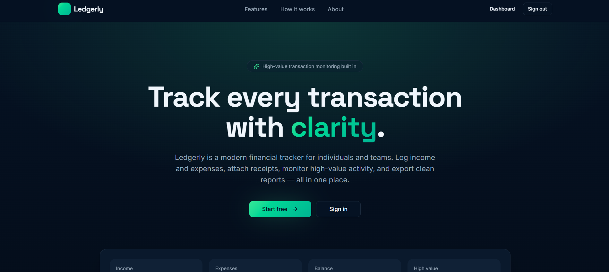
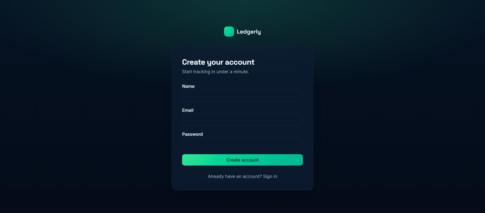
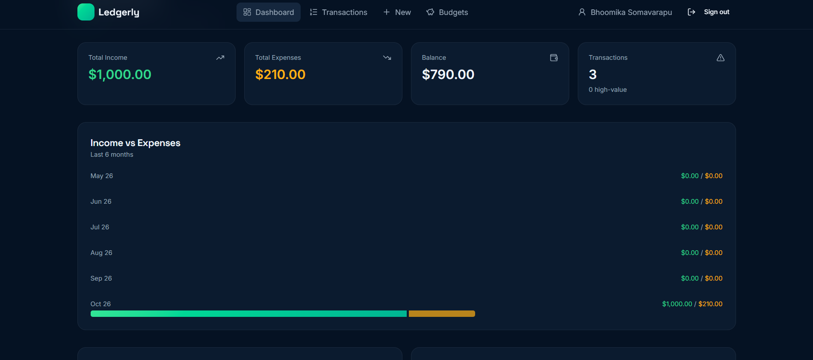
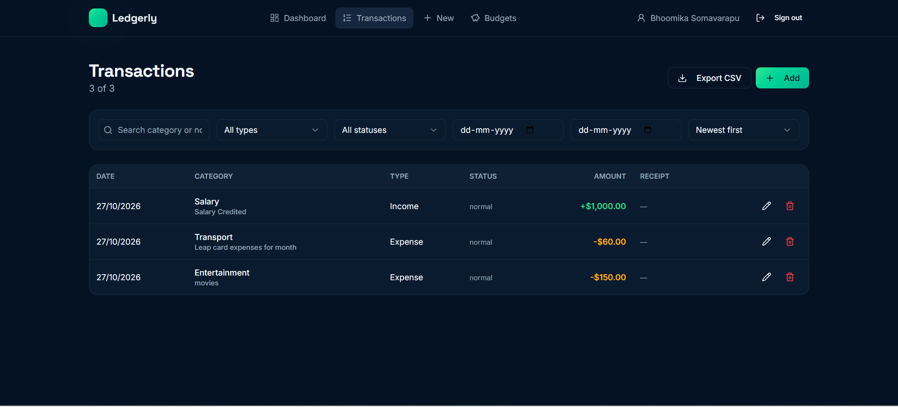
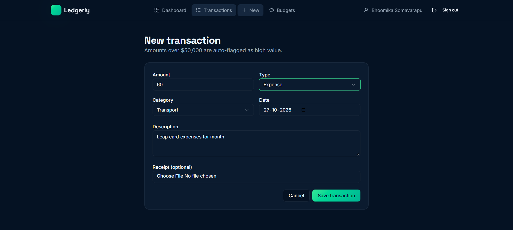
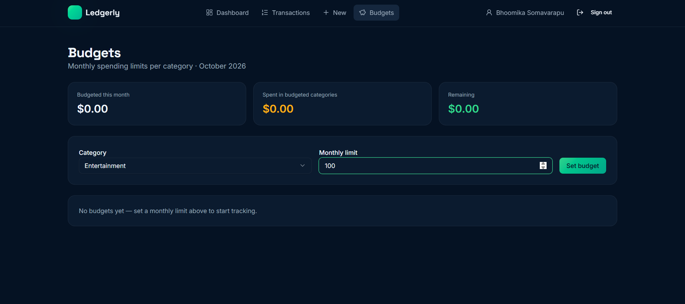
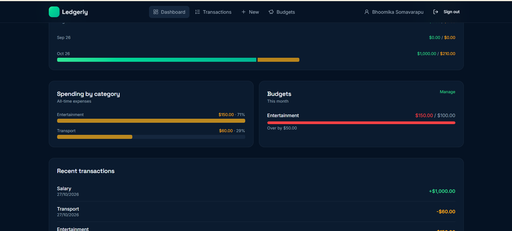
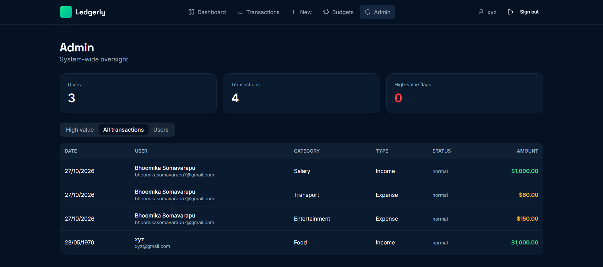
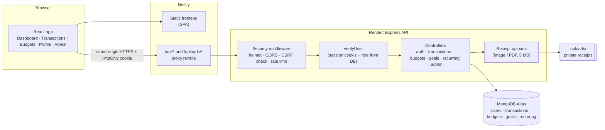

<div align="center">

# 💰 FinTrack 

**A full-stack personal finance tracker: log income and expenses, stay within monthly budgets, and keep every receipt in one secure place.**

[**🌐 Live Demo**](https://personnal-fintrack.netlify.app) · [Features](#-features) · [Screenshots](#-screenshots) · [Architecture](#-architecture) · [Run locally](#-getting-started)


</div>

---

## 📌 At a glance

| | |
|---|---|
| **What** | A web app where each user manages their own money: transactions, receipts, category budgets and a visual dashboard |
| **Stack** | React 19 + TanStack Start + Tailwind (frontend), Node.js + Express 5 + MongoDB (backend), all in **TypeScript** |
| **Hosting** | Frontend on **Netlify**, API on **Render**, database on **MongoDB Atlas** |
| **Auth** | JWT in an HttpOnly cookie, bcrypt hashing, user and admin roles |
| **Highlights** | Instant over-budget alerts, private receipt storage, CSV export, admin panel, and security hardening (CSRF, rate limiting, NoSQL injection protection) |

### What this project demonstrates

- **Full-stack ownership:** I designed and built the REST API, data model, authentication, frontend and deployment myself.
- **Production deployment:** two hosting providers connected through a same-origin proxy so sign-in works in browsers that block third-party cookies (Safari, Brave, incognito).
- **Security thinking:** I found and fixed real vulnerabilities, including password hashes leaking in API responses, login bypass through NoSQL injection, and publicly readable receipts ([details below](#-challenges--how-i-solved-them)).
- **Clean code:** strict TypeScript on both sides, one form component shared by add and edit, and one validator shared by create and update.

---

## 🖼 Screenshots

| Landing page | Sign in / Sign up |
|---|---|
|  |  |

| Dashboard | Transactions |
|---|---|
|  |  |

| Add / edit transaction | Budgets |
|---|---|
|  |  |

| Over-budget alert | Admin panel |
|---|---|
|  |  |

---

## 🎯 Why I built this

Keeping track of personal spending is harder than it should be:

- **You notice overspending too late.** A bank statement tells you at the end of the month that you overspent on food, when you can no longer do anything about it.
- **Receipts get lost** in your inbox, your camera roll or a drawer, away from the payments they belong to.
- **Spreadsheets take effort.** You have to build the formulas and charts yourself, and they never warn you.
- **Unusual payments blend in.** In a long list, one very large payment looks the same as a coffee.

| The problem | How FinTrack Cloud helps |
| ----------- | ------------------------ |
| Not knowing where your money goes | A dashboard with total income, expenses and balance, a 6-month income vs expenses chart, and spending by category |
| Overspending without noticing | A **monthly budget per category**, progress bars, and an **instant warning** as soon as an expense goes over the limit |
| Lost receipts | Attach a photo or PDF receipt to any transaction. Only you can see it |
| Large payments slipping by | Transactions over **$50,000** are automatically flagged **HIGH** |
| Finding old transactions | Search, filter by type, status and date range, and sort by date or amount |
| Getting data out | Export filtered transactions to **CSV** |

---

## ✨ Features

- **Accounts:** sign up, sign in, sign out, update your name, change your password
- **Transactions:** add, edit and delete income or expenses (amount, category, date, note, optional receipt)
- **Receipts:** upload, replace or remove an image or PDF (max 5 MB); only the owner can view them
- **Dashboard:** income, expenses, balance, transaction count, 6-month trend chart, spending by category, budget progress, recent activity
- **Budgets:** one monthly limit per expense category, with a colour scale: green, then amber at 80%, then red when over budget
- **Budget alerts:** a warning toast the moment a new or edited expense pushes a category over its limit
- **High-value flag:** transactions over $50,000 are marked **HIGH**, and the flag updates when the amount changes
- **Search, filter, sort and CSV export** on the transactions page
- **Admin panel:** user and transaction counts, flagged activity, and promoting or demoting admins
- **API only, no UI yet:** savings **goals** with contributions, and **recurring** weekly or monthly transactions

### How a user uses it

1. **Create an account** and sign in.
2. **Add transactions:** salary as income; rent and groceries as expenses. Attach receipts.
3. **Set budgets** for the categories you want to watch (Food, Transport, Entertainment and so on).
4. **Check the dashboard** for your balance, trend, top spending categories and budget usage.
5. **Edit or delete** mistakes. Totals and budgets recalculate automatically.
6. **Export to CSV** for taxes, a spreadsheet or your accountant.

---

## 🛠 Tech stack

| Layer    | Technology |
| -------- | ---------- |
| Frontend | React 19, TanStack Start / Router (file-based routing), Tailwind CSS v4, shadcn/ui (Radix), Recharts, React Hook Form + Zod, Sonner toasts, Lucide icons, Vite 7 |
| Backend  | Node.js, Express 5, TypeScript, Mongoose 9 |
| Database | MongoDB Atlas |
| Auth     | JWT in an HttpOnly cookie, bcryptjs password hashing, role-based access (user / admin) |
| Uploads  | Multer with file type and size checks |
| Security | helmet, express-rate-limit, CORS allow-list, CSRF origin check |
| Hosting  | Netlify (frontend + API proxy), Render (API), MongoDB Atlas (database) |

---

## 🏗 Architecture



**Why the proxy?** The browser only ever talks to `personnal-fintrack.netlify.app`. Netlify forwards `/api/*` to Render, so the session cookie is **first-party**. Browsers that block third-party cookies therefore don't break sign-in.

### What happens when you add an expense

1. You fill in the form and press **Save**. The browser sends the fields and the receipt along with your session cookie.
2. The API identifies you from the cookie and validates every field.
3. The receipt is saved under a random, unguessable filename.
4. The transaction is saved, with a **HIGH** flag if it's over $50,000.
5. A MongoDB aggregation adds up this month's spending in that category. If it's over budget, the response includes a `budget_alert`.
6. The UI shows "Transaction saved" and, if needed, an "Over budget" warning.

### Data model

```
User         { name, email, password (hashed), role: "user" | "admin", createdAt }
Transaction  { user, amount, type: "income" | "expense", category, date, description, file_url, status: "normal" | "high" }
Budget       { user, category, limit }                 // one per category per user, applies every month
Goal         { user, name, target, saved, deadline? }  // savings target
Recurring    { user, amount, type, category, frequency: "weekly" | "monthly", anchor_day, next_date, active }
```

Every record belongs to one user, and users can only ever see their own data.

---

## 🔐 Security & privacy

| Risk | Protection |
| ---- | ---------- |
| Seeing other users' transactions | Every query is scoped to the signed-in user; other users get "not found" |
| Opening someone's receipts | Receipts are served only to their owner (or an admin), under random filenames |
| Stolen passwords | bcrypt hashing; the hash is never returned by the API |
| Password guessing | Auth routes are rate-limited (20 failed attempts per 15 minutes) |
| Account enumeration | Sign-in shows the same "Invalid email or password" message either way |
| NoSQL injection login bypass | Login fields must be plain strings before they reach the database |
| Session theft through XSS | The session is in an HttpOnly cookie that JavaScript can't read |
| Cross-site request forgery | SameSite cookies plus an allow-list check on the request's `Origin` |
| Unsafe uploads | Images and PDFs only, 5 MB max |
| Stale permissions | Roles are read from the database on every request, so changes apply immediately |
| Leaked secrets | `.env` files are git-ignored |

---

## 🧩 Challenges & how I solved them

**1. Instant budget warnings without extra infrastructure**
*Problem:* A warning only helps if it appears while you're adding the expense, but notifications or background jobs would add a lot of moving parts.
*Solution:* After saving an expense, the API runs one MongoDB aggregation for that category and month and returns the result in the same response. The warning appears with no extra request.

**2. Password hashes were included in API responses**
*Problem:* Sign-up and sign-in returned the whole user document, hash included.
*Solution:* The User model removes `password` from every JSON serialisation, so no endpoint can leak it.

**3. Signing in without a password**
*Problem:* Sending `{"email": {"$ne": null}}` turned the login lookup into "match any user".
*Solution:* All auth inputs are checked to be plain strings before they're used in a query.

**4. Receipts were publicly viewable**
*Problem:* Anyone with a receipt's link could open it.
*Solution:* Receipts are served through an authenticated route that checks ownership. Filenames are random, and files are deleted together with their transaction or when replaced.

**5. Sign-in failed in production but worked locally**
*Problem:* With the frontend on Netlify and the API on Render, the session cookie was third-party. Safari, Brave and incognito windows silently dropped it.
*Solution:* Netlify now proxies `/api/*` and `/uploads/*` to Render (`client/public/_redirects`), so the browser treats the API as same-origin and the cookie as first-party.

**6. "Origin not allowed" errors in production**
*Problem:* The CSRF guard compares the request's `Origin` against `CLIENT_URL`. A small difference such as a trailing slash rejected every POST.
*Solution:* Configured origins are normalised (trimmed, trailing slashes removed) before the comparison.

**7. The date filter left out the last day**
*Problem:* Comparing full timestamps with plain dates dropped transactions on the "to" date.
*Solution:* Only the `YYYY-MM-DD` part is compared, so both ends of the range are included.

**8. Role changes needed a fresh sign-in**
*Problem:* The role was stored in the JWT, so a database change had no effect for up to 7 days.
*Solution:* The role is loaded from the database on each request.

**9. Keeping the add and edit forms in sync**
*Solution:* One shared `TransactionForm` component powers both pages, and one shared validator checks both create and update requests on the server.

---

## 🚀 Getting started

### Prerequisites
- Node.js **22+** (required by TanStack Start)
- MongoDB, either local or a free [MongoDB Atlas](https://www.mongodb.com/atlas) cluster

### 1. Clone

```bash
git clone https://github.com/bhoomikaaa20/fintrack-cloud.git
cd fintrack-cloud
```

### 2. Start the API

Create `server/.env`:

```env
PORT=5000
MONGO_URI=mongodb://localhost:27017/fintrack
JWT_SECRET=replace-with-a-long-random-string
CLIENT_URL=http://localhost:8080
```

```bash
cd server
npm install
npm run dev               # http://localhost:5000  (health check: /api/health)
```

### 3. Start the frontend

Create `client/.env`:

```env
VITE_API_URL=http://localhost:5000
```

```bash
cd client
npm install
npm run dev               # http://localhost:8080
```

Open http://localhost:8080, create an account and add your first transaction.

### Environment variables

| Variable | Where | Description |
| -------- | ----- | ----------- |
| `MONGO_URI` | server | MongoDB connection string (the last path segment is the database name) |
| `JWT_SECRET` | server | Secret for signing sessions (required) |
| `PORT` | server | API port (default `5000`; set automatically on Render) |
| `CLIENT_URL` | server | Comma-separated frontend origins allowed to call the API |
| `API_PUBLIC_URL` | server | Public base URL used in receipt links |
| `NODE_ENV` | server | `production` enables secure cookies |
| `VITE_API_URL` | client | API base URL (`/` in production, so requests go through the Netlify proxy) |

### Scripts

| Location | Command | Purpose |
| -------- | ------- | ------- |
| server | `npm run dev` | API with hot reload |
| server | `npm run build` then `npm start` | Production build and run |
| server | `npm run typecheck` | Type check |
| server | `npm run make-admin -- <email>` | Give an account admin access |
| client | `npm run dev` | Frontend dev server |
| client | `npm run build` | Production build |

---

## ☁️ Deployment

| Part | Platform | Settings |
|---|---|---|
| API | **Render** (Web Service) | Root `server` · Build `npm install --include=dev && npm run build` · Start `npm start` · Env: `NODE_ENV=production`, `MONGO_URI`, `JWT_SECRET`, `CLIENT_URL` and `API_PUBLIC_URL` = the Netlify URL |
| Frontend | **Netlify** | Configured by [`netlify.toml`](netlify.toml): base `client`, build `npm run build`, publish `dist/client`, Node 22, `VITE_API_URL=/` |
| Proxy | **Netlify** | [`client/public/_redirects`](client/public/_redirects) forwards `/api/*` and `/uploads/*` to Render and adds the SPA fallback |
| Database | **MongoDB Atlas** | Network access `0.0.0.0/0` so Render can connect |

> Receipts are stored on the API server's disk. Render's free tier wipes the disk on every redeploy, so production storage should use a persistent disk or S3 / Cloudflare R2.

---

## 👑 Admin access

New accounts are always regular users. To create the first admin:

1. **MongoDB Atlas / Compass:** in the `users` collection, set `role` to `"admin"`, or
2. **CLI:** `cd server && npm run make-admin -- you@example.com`

After that, an admin can promote other users from **Admin → Users**. Roles are checked on every request, so a refresh is enough.

---

## 📡 API reference

All responses are JSON. Signed-in routes use the `token` HttpOnly cookie (`credentials: "include"`).

| Method | Endpoint | Access | Description |
| ------ | -------- | ------ | ----------- |
| POST | `/api/auth/signup` | public | Create an account `{ name, email, password }` |
| POST | `/api/auth/login` | public | Sign in `{ email, password }` |
| POST | `/api/auth/logout` | public | Sign out |
| GET | `/api/auth/me` | signed in | Current user |
| PATCH | `/api/auth/profile` | signed in | Update `{ name }` |
| PATCH | `/api/auth/password` | signed in | Change password `{ currentPassword, newPassword }` |
| GET | `/api/transactions` | signed in | List your transactions |
| GET | `/api/transactions/:id` | owner | Get one transaction |
| POST | `/api/transactions` | signed in | Create (multipart: `amount, type, category, date, description, file?`) |
| PUT | `/api/transactions/:id` | owner | Update (same fields, plus optional `remove_file=true`) |
| DELETE | `/api/transactions/:id` | owner | Delete the transaction and its receipt |
| GET | `/api/budgets` | signed in | Budgets with this month's spending |
| PUT | `/api/budgets` | signed in | Create or update `{ category, limit }` |
| DELETE | `/api/budgets/:id` | owner | Remove a budget |
| GET | `/api/goals` | signed in | List savings goals |
| POST | `/api/goals` | signed in | Create `{ name, target, deadline? }` |
| POST | `/api/goals/:id/contribute` | owner | Add money to a goal |
| DELETE | `/api/goals/:id` | owner | Delete a goal |
| GET | `/api/recurring` | signed in | List recurring rules |
| POST | `/api/recurring` | signed in | Create a weekly or monthly rule |
| PATCH | `/api/recurring/:id` | owner | Update or pause a rule |
| DELETE | `/api/recurring/:id` | owner | Delete a rule |
| GET | `/uploads/:filename` | owner or admin | View a receipt |
| GET | `/api/admin` | admin | All users and transactions |
| PATCH | `/api/admin/users/:id/role` | admin | Set `{ role: "user" \| "admin" }` |
| GET | `/api/health` | public | Health check |

Creating or updating an expense returns `budget_alert: { category, limit, spent }` when that category goes over budget, otherwise `null`.

---

## 📁 Project structure

```
fintrack-cloud/
├── netlify.toml                         # Netlify build config
├── client/                              # React frontend
│   ├── public/_redirects                # API proxy + SPA fallback
│   └── src/
│       ├── routes/                      # One file per page (file-based routing)
│       │   ├── index.tsx                #   Landing page
│       │   ├── auth.tsx                 #   Sign in / sign up
│       │   ├── dashboard.tsx            #   Overview, trend, categories, budgets
│       │   ├── transactions.index.tsx   #   List, search, filter, sort, export
│       │   ├── transactions.new.tsx     #   Add a transaction
│       │   ├── transactions.$id.edit.tsx#   Edit a transaction
│       │   ├── budgets.tsx              #   Monthly budgets
│       │   ├── profile.tsx              #   Name and password
│       │   └── admin.tsx                #   Admin panel
│       ├── components/                  # AppShell, TransactionForm, BudgetBar, shadcn/ui kit
│       └── lib/                         # Auth context, API client, constants
└── server/                              # Express API
    └── src/
        ├── config/                      # Environment + database connection
        ├── controllers/                 # auth, transactions, budgets, goals, recurring, admin
        ├── middleware/                  # Auth check, admin check, uploads
        ├── models/                      # User, Transaction, Budget, Goal, Recurring
        ├── routes/                      # REST routes + private receipts
        └── scripts/make-admin.ts        # CLI: give an account admin access
```

---

## 🧑‍💻 Author

**Bhoomika Somavarapu** · [GitHub @bhoomikaaa20](https://github.com/bhoomikaaa20)

If you like this project, consider giving it a ⭐.
